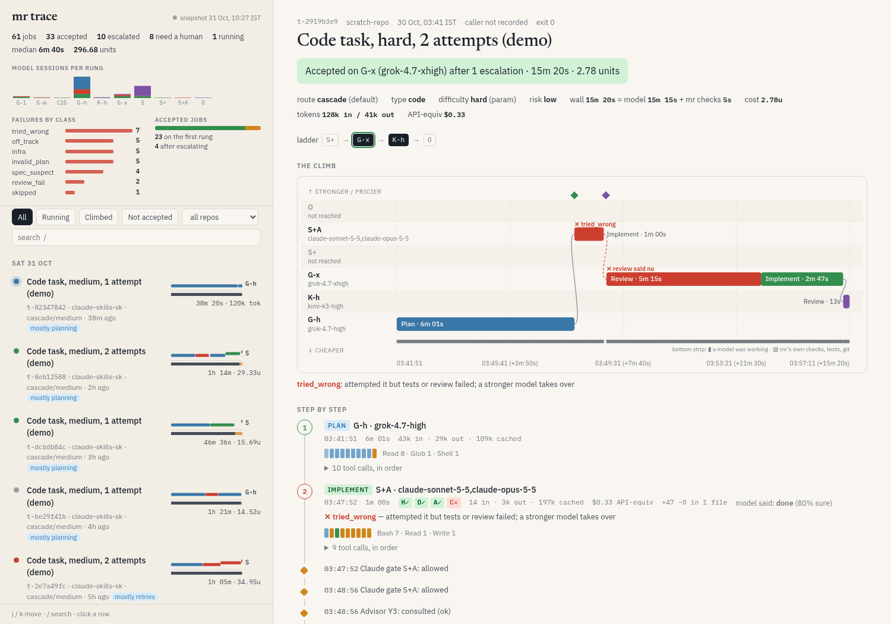
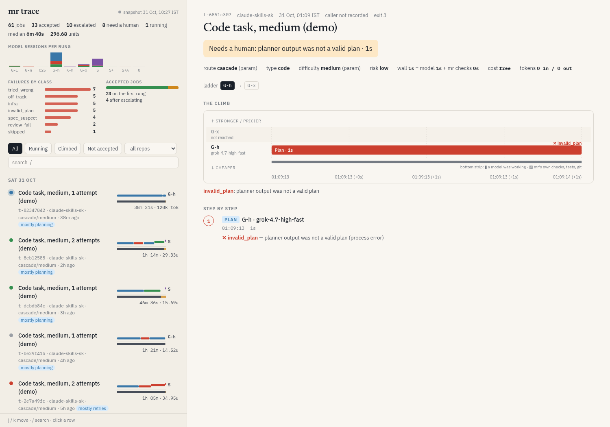
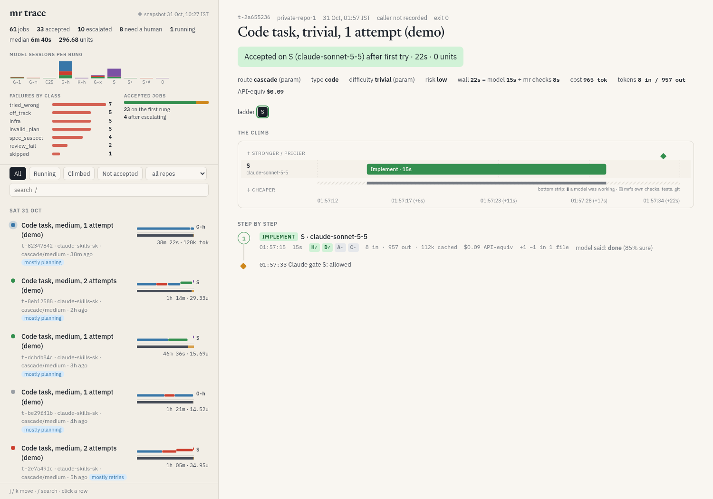

# mr-trace

See every job that went through **mr** (Rohan's model router) at a glance: which models it climbed through,
where it failed and why, where the time went, and how it ended. No log reading.



**Live demo (scrubbed data):** https://ronitron007.github.io/mr-trace/

## The idea in one line

An mr job is a **climb up a price ladder** until something passes the checks. So the main picture is a
ladder chart: time runs left to right, the model rung runs from cheap (bottom) to expensive (top), and red means that
attempt failed, with the reason in words. See [docs/DESIGN.md](docs/DESIGN.md) for the first-principles reasoning
and the three spikes (git graph, flow chart, ladder), and [docs/RESEARCH.md](docs/RESEARCH.md) for what we took from
LangSmith, Langfuse, Phoenix, Jaeger, Temporal and coding-agent runtimes.

## Use it (on the box where mr runs; Python 3.10+, stdlib only)

```bash
cd /workspace/mr-trace
python3 -m mrtrace serve                 # live: http://127.0.0.1:8765  (refreshes every 4 s while jobs run)
python3 -m mrtrace build -o mr-trace.local.html   # one self-contained HTML file you can open or send
python3 -m mrtrace show t-2919b3e9       # the story of one job in the terminal
python3 -m mrtrace demo                  # scrubbed snapshot for publishing (docs/index.html)
```

Keys: `j`/`k` move between jobs, `/` search. Filters: Running, Climbed, Not accepted, per repo.

## What it reads (read-only; nothing in mr changes)

| Source | Gives |
|---|---|
| `/home/box/mr/log/runs.jsonl` | route, planner/implementer/reviewer steps, guard and advisor events, task outcome and cost |
| `/home/box/mr/raw/<task>/a<n>-<model>.out` | the model's MR_RESULT (done / pushback / blocked), pushback evidence, last words, tokens, $ |
| `/home/box/mr/tasks/<task>/state.json`, `patches/<task>/FINAL.md` | the planner's goal (title) and mr's "why it stopped" |
| `~/.cursor/projects/*/agent-transcripts/<session>/*.jsonl` | every tool call of a cursor attempt, in order |
| process table | the step that is running right now (live mode) |

`MR_HOME` overrides `/home/box/mr`.

## Screens

| Needs a human (spec looked wrong twice) | Private repos are aliased in the public demo |
|---|---|
|  |  |

## Privacy

`python3 -m mrtrace demo` gives private repos aliases and replaces their titles. It drops prompts, model words,
pushback text, tool arguments, paths and session ids, and refuses to write if anything secret-looking survives (`mrtrace/scrub.py`).
Real snapshots (`*.local.html`) are git-ignored.

## Proposals for mr

See [proposals/](proposals/): record `title` and `caller` on the task record (a 20-line patch), write a `step_start`
record, and use stream-json for cursor rungs.

## Tests

`python3 -m unittest discover -s tests -t .`

## Built through mr

Parts of this repo were routed through mr itself, and those jobs are in the demo. `narrate.py` was written by claude-sonnet-5-5 in
job t-38ba36a1. mr then rejected the job as `off_track` because I had left my own untracked notes in the tree, and
the trace shows exactly that. Jobs t-6886965c and t-9763fa8d failed as `infra` / `invalid_plan` because the
box's cursor-agent was logged out (both are visible in the view as 1-second red bars).
