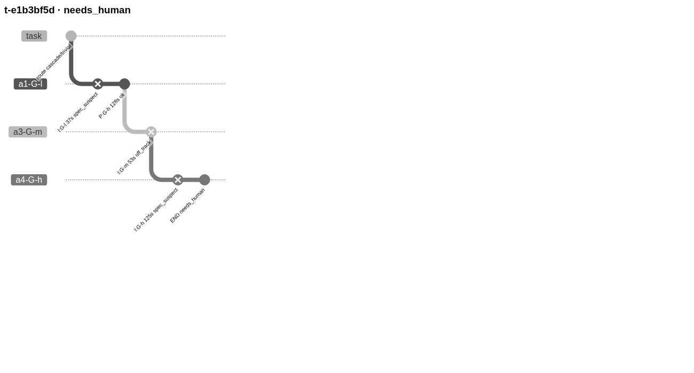
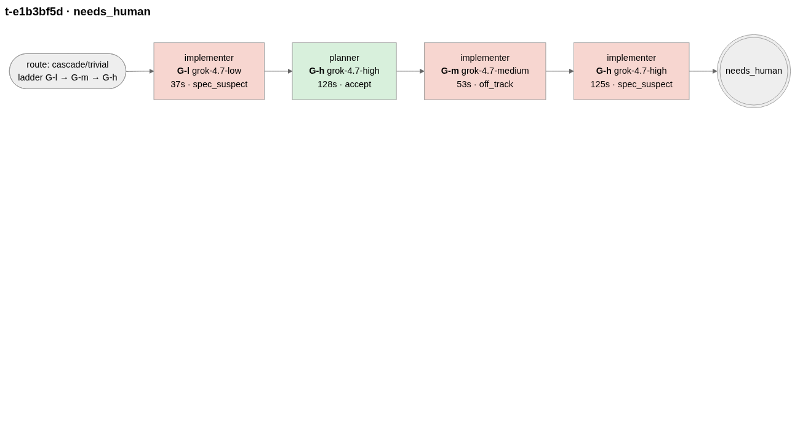
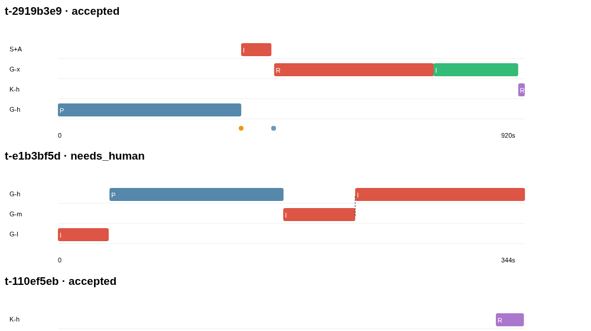

# Why the view looks like this

Written 31 Oct 2026 by Outbox (Rohan's first-principles bot). Rohan asked for a way to *look at* what an
agent did through `mr`, without going back and forth through logs.

## 1. First principles: what does Rohan need to see?

An mr job is not a generic trace. It is **a climb up a price ladder until something passes the checks**:

route → (planner) → cheap model tries → checks (H/D/A/C) → fail → classify why → stronger model / same model with more effort /
back to planner / reset → … → accepted or a human is needed.

So the questions he asks while looking are, in order:

| # | Question | What answers it in the view |
|---|---|---|
| 1 | What is running now, and did anything go wrong recently? | Board: one row per job, a coloured dot, a pulsing dot for a live job, filters "Running" and "Not accepted" |
| 2 | How did this job end, in one sentence? | Headline: "Accepted on G-x after 1 escalation · 15m 20s · 2.78 units", or "Needs a human: the spec itself looks wrong…" plus mr's own "why it stopped" |
| 3 | How far up the ladder did it climb, and why each time? | Ladder chart: y = rung (cheap at the bottom), x = clock time, red = that step failed, with the failure class in words |
| 4 | Where did the time go? | Bar lengths, plus the bottom strip: model time vs mr's own checks |
| 5 | Which model did what, and what did it actually do? | Step cards: role, rung, model, duration, tokens, signal chips H D A C, diff size, the model's own MR_RESULT, its pushback, and a tool strip (each tick is a tool call: read, search, edit, shell) |
| 6 | Can I trust "done"? | Signal chips per step; the model's stated confidence; patch and raw paths to drill in |
| 7 | What did it cost? | Units, Claude points, tokens, API-equivalent $ per job and per step |

Things deliberately **not** shown: prompts and full transcripts (one click away as "N tool calls, in order"),
token-level charts, dashboards of averages. Hamel Husain's point that a simple data viewer over real examples
beats generic dashboards holds here.

## 2. The trace data model (derived from the questions, not from a tool)

```
Job (trace)
  task, title, repo, caller, status, exit, why (FINAL.md), route/type/difficulty/risk (+ where each came from),
  ladder, cost {units, claude_pts, usd_equiv, tok_in, tok_out}, t0, t1, wall_s
  steps[]   one per model session: role (planner|implementer|reviewer), rung, model, t0, t1, ok,
            failure_class (+ plain meaning), signals {H,D,A,C}, diff, mr_result, pushback, confidence,
            tokens, usd, tools[] (name, kind, short hint), escalated_from, live
  events[]  Claude gate checks and advisor decisions, at their timestamps
```

Everything comes from what mr already writes (`log/runs.jsonl`, `raw/`, `tasks/*/state.json`,
`patches/*/FINAL.md`) plus cursor-agent's own transcript of each attempt (joined on `session_id`).
mr needed **no new logging** to get here. The two gaps (task title and calling agent) are a small
patch proposed in `proposals/`.

## 3. Spikes (same 3 real jobs in each)

| Spike | Picture | Verdict |
|---|---|---|
| A. Git graph (Mermaid gitGraph): each attempt a branch, accept = merge |  | It does show the climb as a staircase. But mr's attempts are sequential, so the branches and merges are made up. The labels rotate and can't be read, there's no time axis, and several diagrams on one page break. **Rejected.** |
| B. Flow chart (Mermaid flowchart): one box per step |  | The easiest to read as text. But every job becomes the same left-to-right chain: you can't see time or cost, and a 7-step job runs off the screen. **Kept as an idea**: the step cards are this, turned vertical. |
| C. Ladder / waterfall: x = time, y = rung |  | The only one where you *see* the escalation and where the time went. In 2 of the 3 jobs the planner took most of the wall time, which no log line tells you. It needed labels. **Winner, combined with B's readable cards.** |

The shipped view combines all three:

1. **Board** (all jobs; small multiples): every row has a 132-px mini-ladder, so the whole day's
   "shape of work" can be scanned in seconds. Red bars stand out; a tall glyph means the job climbed.
2. **Ladder chart** for the selected job (spike C, with labels, failure words, hand-off lines, gate
   events and a model-vs-mr time strip).
3. **Step cards** (spike B, vertical) with the evidence: signals, pushback, the model's last words and a tool strip.

## 4. What we took from outside tools

See `RESEARCH.md`.

## 5. Known limits

- mr writes a step only when it finishes. The live view adds the step that is running from the process
  table (the model's CLI process names the task id). That is good enough to watch, but not exact.
- cursor-agent transcripts have no per-tool timestamps, so the tool strip is ordered but not to scale.
- Claude rungs only have tool calls when mr used `stream-json` (S+A). The proposal suggests stream-json everywhere.
- Most older jobs have no title because mr's task record sets `title: null`. The patch in `proposals/` fixes this.
